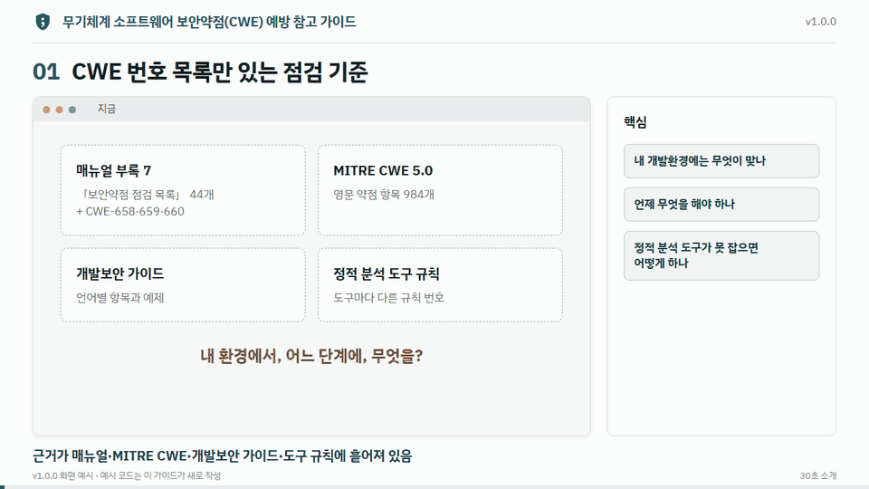

# 무기체계 소프트웨어 보안약점(CWE) 예방 참고 가이드

무기체계 임베디드 소프트웨어 개발자가 CWE 보안약점을 요구사항 분석·설계·구현·통합 및 시험·유지보수의 수명주기 5단계에서 예방하기 위한 **개발자 참고 가이드(권고형)** 와 지침 선택 도구를 정적 웹사이트로 공개하는 저장소이다.

- 대상 보안약점: 방위사업청 「무기체계 소프트웨어 개발 및 관리 매뉴얼」(제2024-6호)의 「보안약점 점검 목록」 44개 + CWE-658(C)·659(C++)·660(Java) 구성원 — 197개
- 개발환경: 탑재 환경·운영체제/런타임·IDE/컴파일러·기반 소프트웨어·개발 언어·개발·시험 망 6축 25종, 환경별 지침 245건, 기준선 활동 33개
- 근거: MITRE CWE 5.0, 매뉴얼 제2024-6호, SSDF 1.1, 행정안전부·KISA 가이드, SEI CERT, 참조 오픈소스 프로젝트(태그 고정, 원문 대조). 모든 근거에 원문 링크를 단다

온라인판과 폐쇄망판으로 배포하고, 폐쇄망판은 사이트와 단일 문서 두 가지 묶음으로 낸다.

| 형태 | 보는 곳 | 특징 |
|---|---|---|
| 온라인판 | GitHub Pages(`https://minkwanchoi.github.io/ws-cwe-guide/`) | 판 선택 메뉴(mike)로 판별 사이트를 본다. 글꼴 등 자원은 사이트 안에 있어 외부 호출이 없다(외부 원문 링크는 누를 때만 열림) |
| 폐쇄망판(사이트) | GitHub 릴리스의 `ws-cwe-guide-offline-v{판}.zip`(약 11 MB) + `SHA256SUMS.txt` | 인터넷 없이 `index.html`을 파일로 열거나 내부 웹서버에 올려 본다. 검색·지침 선택 도구·규칙별 해설(CWE 원문 포함)·Excel이 모두 들어 있다. 외부 원문 링크는 인터넷 환경에서만 열린다 |
| 폐쇄망판(단일 문서) | GitHub 릴리스의 `ws-cwe-guide-single-v{판}.zip`(약 2 MB) + `SHA256SUMS.txt` | 본문·부록·규칙별 해설을 담은 HTML 파일 하나(스크립트 없음)와 지침 선택 도구·CWE 버전 비교 파일, Excel 2종. 찾기는 Ctrl+F, 인쇄·PDF 저장이 된다. 검색창·왼쪽 탐색·검증 방법 페이지는 없다 |

> 이 가이드는 준수 의무를 정하는 규정이 아니다. 오픈소스 사례는 지침이 실제 임베디드 코드에서 쓰이는 방식을 보여 줄 뿐 무기체계 적합성을 입증하지 않는다.

## 30초 소개



<sub>v1.0.0 화면 예시. 예시 코드는 이 가이드가 새로 작성한 것이다.</sub>

## 저장소 구성

```
source/                원천(사람이 고치는 곳)
  guide/               본문 원고(Markdown, 장별 파일)·부록 G·참고문헌
  data/                지침·태깅·근거·용어 데이터(JSON) — 부록 A~F, 지침 선택 도구, Excel이 여기서 생성된다
  evidence/            검증 방법 요약(사이트 '검증 방법')
  assets/              사이트 스타일
scripts/
  build.py             source/ → docs/ 생성(부록·지침 선택 도구·Excel·근거 링크 변환·각주 점검), --offline이면 폐쇄망판 원고
  site_build.py        원고 생성 → MkDocs 빌드(경고 0 확인) → (폐쇄망판) 단일 문서판 생성·외부 자원·내부 링크 점검·묶음까지 한 번에
  gen_single_html.py   폐쇄망판 원고 → site-single/ 단일 문서(HTML 하나) + 지침 선택 도구 + Excel
  package_offline.py   site-offline/·site-single/ → dist/ 의 zip 2개와 SHA-256 해시
  check_offline.py     빌드된 사이트가 외부 서버에서 불러오는 자원이 없는지 점검
  check_internal_links.py  빌드된 사이트의 내부 링크가 실제 파일을 가리키는지 점검
  check_links.py       근거 링크 실존 확인
  gen_*.py, linkify.py, lib.py, templates/
docs/, site/, site-offline/, site-single/, dist/   생성물(커밋하지 않음)
media/intro-preview.gif  README의 30초 소개 화면
mkdocs.yml             온라인판 설정(MkDocs Material + mike 판 관리 + privacy 플러그인으로 외부 자원 내장)
mkdocs.offline.yml     폐쇄망판 설정(mkdocs.yml을 이어받고 .html 주소·offline 플러그인·판 메뉴 끔)
VERSION                현재 판 번호(SemVer)
CHANGELOG.md           판별 변경 내역
```

## 내 컴퓨터에서 보기

```bash
python -m pip install -r requirements.txt
python scripts/build.py
python -m mkdocs serve
```

브라우저에서 `http://127.0.0.1:8000`을 연다. 원고(`source/`)를 고친 뒤에는 `python scripts/build.py`를 다시 실행한다.

폐쇄망판을 만들려면 다음을 실행한다. `dist/`에 사이트판·단일 문서판 zip과 `SHA256SUMS.txt`가 생긴다. 글꼴과 검색 셰임은 저장소에 들어 있어 빌드도 묶음도 인터넷 없이 된다(패키지 설치 때만 PyPI가 필요하다).

```bash
python scripts/site_build.py --offline
```

Windows에서는 privacy 플러그인이 심볼릭 링크를 만들지 못해 경고를 내지만 파일 복사로 대신 처리한다. `site_build.py`는 이 경고만 허용하고 나머지 경고가 있으면 실패한다(Linux CI에서는 이 경고가 나지 않는다).

## 처음 배포하기 (GitHub Pages)

1. GitHub 계정 `minkwanchoi`에 공개 저장소 `ws-cwe-guide`를 만들고 이 폴더를 올린다.
2. 다른 계정(또는 조직)에 올리면 `mkdocs.yml`의 `site_url`, `extra.social`의 저장소 링크와 이 문서의 주소에서 `minkwanchoi`를 그 이름으로 바꾼다.
3. `v1.0.0` 태그를 올리고 **Actions → publish** 워크플로가 `gh-pages` 브랜치를 만들 때까지 기다린다. `main` 푸시만으로는 사이트에 올라가지 않는다.
4. **Settings → Pages → Build and deployment → Source: Deploy from a branch**, 브랜치 `gh-pages` / `(root)`를 고른다.
5. `https://minkwanchoi.github.io/ws-cwe-guide/`에서 사이트가 열린다. 사이트에는 `v*` 태그로 발행한 판만 게시된다.

## 판 관리와 배포

| 하는 일 | 방법 | 결과 |
|---|---|---|
| 작업 중인 내용 점검 | `main`에 푸시 | 사이트에는 올리지 않는다. 빌드·점검을 돌리고 폐쇄망판 zip 2개를 워크플로 산출물(offline)로 보관 |
| 정식 판 발행 | `VERSION`과 `CHANGELOG.md`를 고치고 커밋한 뒤 `git tag v1.0.0 && git push origin v1.0.0` | `1.0` 판 생성, `latest` 별칭이 그 판을 가리키고 기본 판이 된다. GitHub 릴리스에 Excel 2종과 폐쇄망판 zip 2개·SHA256SUMS.txt 첨부 |
| 수정 판(오탈자·링크) | `v1.0.1` 태그 | 같은 `1.0` 판을 덮어쓴다 |
| 이전 판 보기 | 사이트 위쪽 판 선택 메뉴 | 판별 사이트가 `gh-pages`에 그대로 남는다 |

판 번호 규칙은 [CONTRIBUTING.md](CONTRIBUTING.md)에 있다. 태그와 `VERSION`이 다르면 배포가 멈춘다.

## 폐쇄망에 반입하기

1. 인터넷 환경에서 GitHub 릴리스의 zip(사이트판 `ws-cwe-guide-offline-v{판}.zip` 또는 가벼운 단일 문서판 `ws-cwe-guide-single-v{판}.zip`)과 `SHA256SUMS.txt`를 받는다.
2. 출처를 확인한다 — GitHub CLI로 `gh attestation verify <zip> --repo minkwanchoi/ws-cwe-guide`. 릴리스의 zip이 이 저장소 원천으로 GitHub Actions에서 만들어졌는지 확인하므로, zip과 해시 파일을 함께 바꿔치기한 경우도 걸린다.
3. 해시를 확인한다 — Windows `certutil -hashfile <zip> SHA256`, Linux `sha256sum -c SHA256SUMS.txt`.
4. 기관의 매체 반입 절차(승인·악성코드 검사)에 따라 반입한 뒤, 반입 측에서 해시를 다시 대조한다.
5. 압축을 풀고 사이트판은 `index.html`, 단일 문서판은 `가이드(단일문서).html`을 브라우저로 연다. 여러 사람이 볼 때는 폴더를 내부 웹서버(IIS·nginx·Apache 등)나 문서 게시판에 폴더째 올린다.

zip 안의 읽어보기 파일(`읽어보기(폐쇄망판).txt`, `읽어보기(단일문서판).txt`)에 같은 절차와 원천 커밋이 적혀 있다.

## 자동 점검

- **check / build**(끌어오기 요청마다): 온라인판·폐쇄망판(사이트·단일 문서) 생성과 `mkdocs build --strict`, 내부 링크 점검(`check_internal_links.py`), 외부 자원 점검(`check_offline.py`), 받아 온 자원의 해시 대조(`check_assets.py`)
- **publish**(main·태그): 읽기 권한만 가진 작업에서 빌드·점검·폐쇄망판 묶음을 만들고, 태그일 때만 gh-pages 게시와 릴리스 첨부를 쓰기 권한으로 한다. 태그 릴리스의 zip·Excel에는 출처 증명을 붙인다
- 모든 작업은 해시를 고정한 `requirements-lock.txt`로 패키지를 설치하고, 워크플로 액션은 커밋 해시로 고정한다. 보안 문제 신고는 [SECURITY.md](SECURITY.md)
- **check / links**(매주 월요일): 근거 링크(CWE·CERT·매뉴얼·오픈소스 원문 등)를 접속해 보고서를 남기고, 404·410이 있으면 실패로 표시

## 출처와 이용 조건

제3자 자료(CWE, CVE, Microsoft Learn, SEI CERT, MISRA, 방위사업청 매뉴얼, 오픈소스 등)의 출처와 조건, 라이선스 적용 제외 범위는 [NOTICE.md](NOTICE.md)에 있고, 사이트에서는 '출처와 이용 조건' 페이지로 볼 수 있다. 함께 배포하는 테마·글꼴의 라이선스는 [THIRD-PARTY-NOTICES.txt](source/guide/THIRD-PARTY-NOTICES.txt)에 있다. 이 저장소에서 작성자가 쓴 원고·데이터·스크립트·예시 코드는 [MIT 라이선스](LICENSE)이다(제3자 자료 제외). 교육·연구 목적으로 공개하지만 MIT는 이용 목적을 제한하지 않는다.
